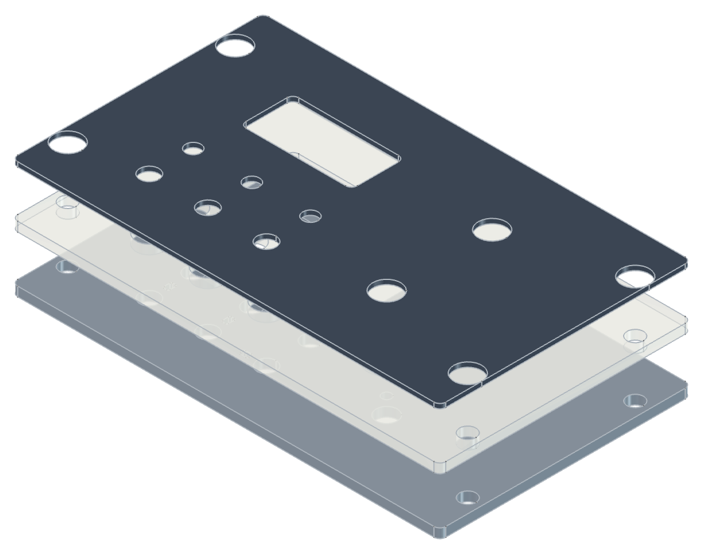
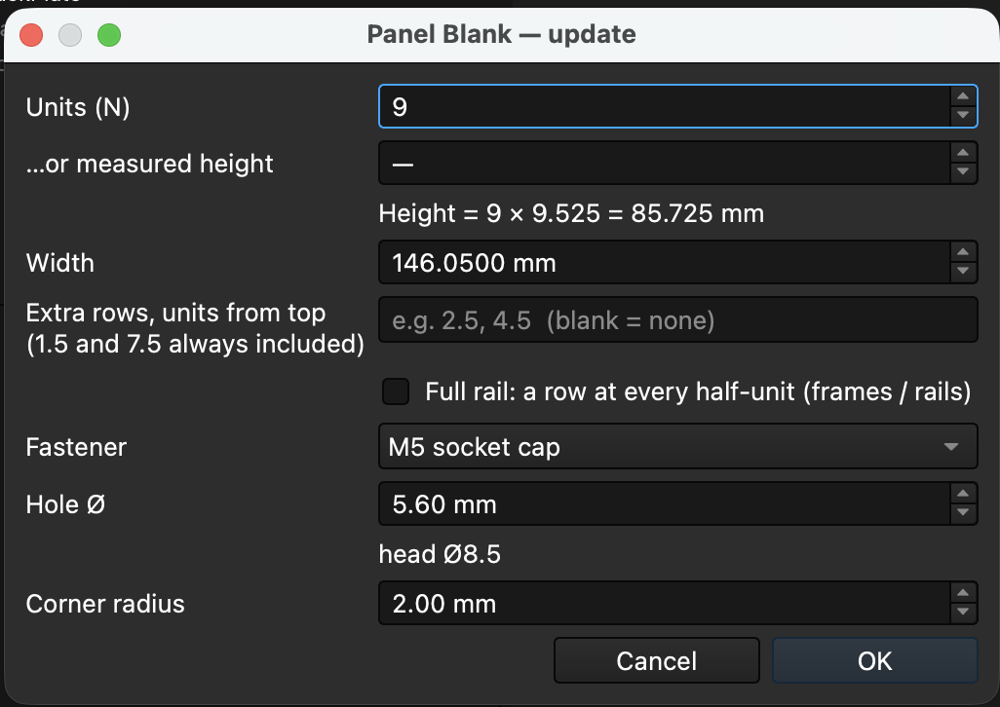
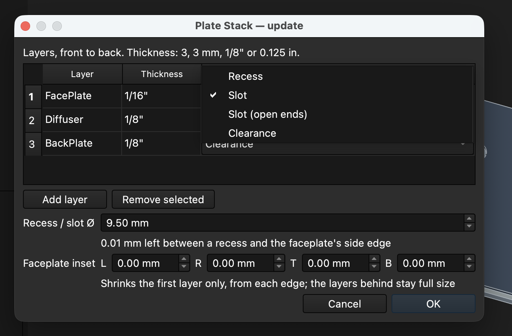
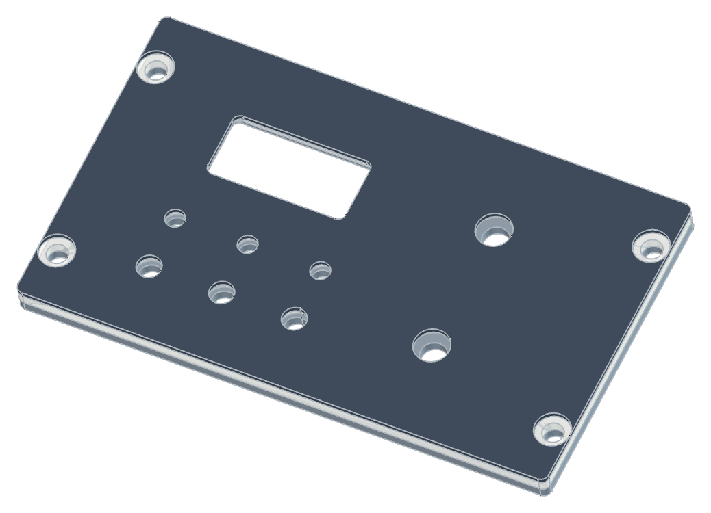
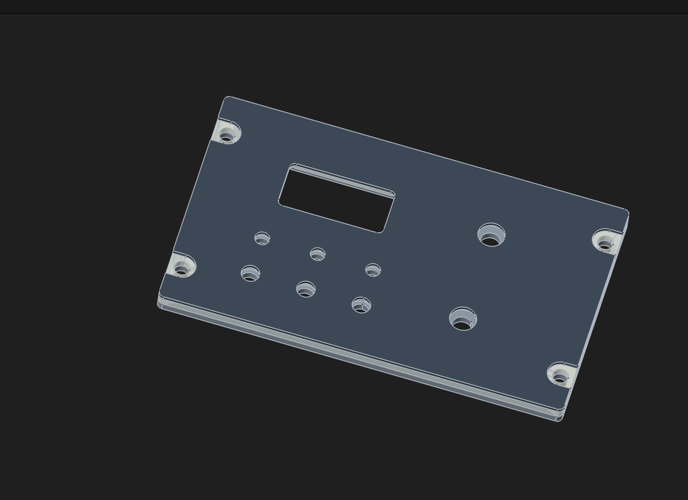
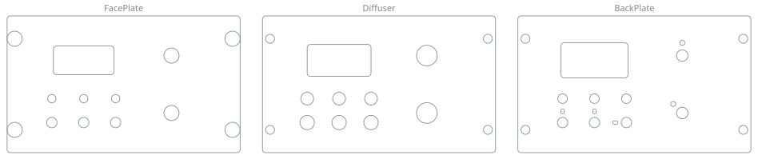
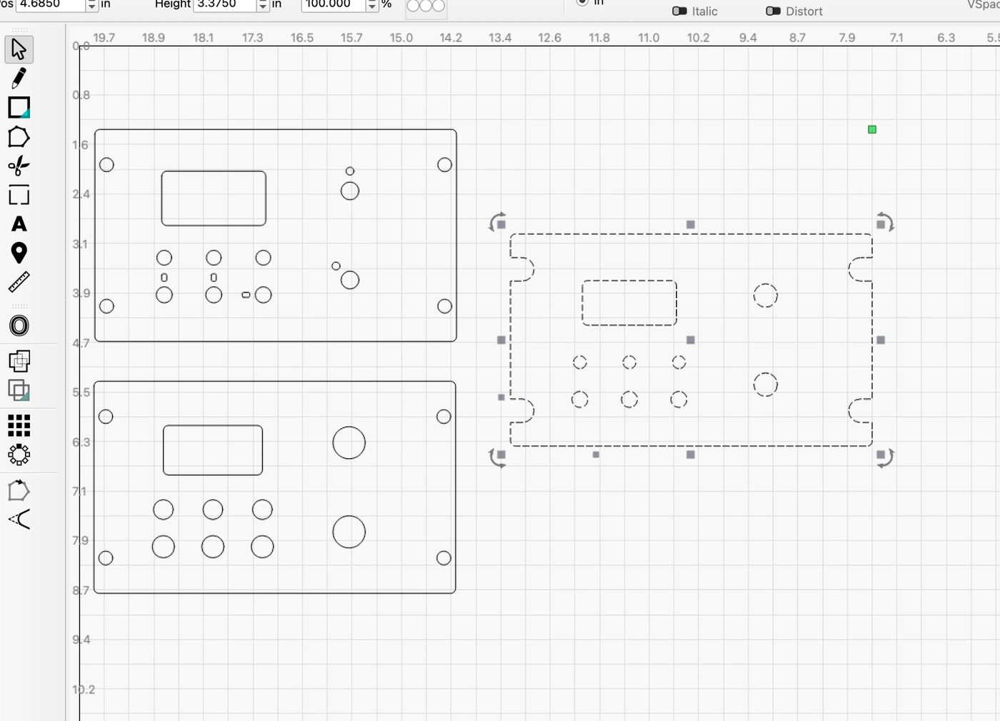

# Cockpit Panels

<p align="center"></p>

<p align="center"><em>A 9-unit example panel: faceplate, diffuser and backplate, pulled apart. Each layer has its own cutouts for the same display, two rotaries, three toggles and three LEDs.</em></p>

A FreeCAD workbench for building home-cockpit (simpit) panels. It is built so more tools can be added; today it has three, used in this order:

1. **Panel Blank** draws the base for a Dzus-rail console panel: the outline, a mount point at every fastener position on the rail grid, and a clearance hole at each one.
2. **Plate Stack** turns the blank into the physical layers (faceplate, diffuser, backplate, ...): one padded Part Design Body per layer, stacked front to back at its real thickness, each with its own fastener cut (plain hole, recess for the screw head, or a slot open to the edge).
3. **Export Layers** writes one DXF cut file per plate, holding that plate's outline, holes and cutouts.

You add your control cutouts in between. Everything the tools create is a plain FreeCAD object (spreadsheets, sketches, Part Design features), and Export Layers only writes files. Your panel files open and recompute on any FreeCAD 1.1+, with or without this workbench installed.

## The panel grid

Classic US military side-console panels follow one standard:

| | Value |
|---|---|
| Width | 146.05 mm (5¾″) |
| Height | N × 9.525 mm (N × ⅜″), N ≥ 4 |
| Fastener columns | half a pitch in from each side edge, 136.525 mm (5⅜″) apart |
| Outer fastener rows | 1.5 pitch in from the top and bottom edges |
| Extra rows | any half-unit row between the outer ones (2.5, 3.5, …) |

Because every panel sits on the same grid, stacked panels keep 28.575 mm (3 pitches) between fastener rows across the joint, the same as within a panel.

## Install

**Addon Manager (recommended)**

Cockpit Panels is not in FreeCAD's official addon catalog yet, so add it as a custom repository first (FreeCAD 1.1):

1. Open **Tools → Addon Manager** once, then close it. Its settings page only appears in Preferences after it has been opened.
2. Open Preferences (**FreeCAD → Preferences…** on macOS, **Edit → Preferences…** on Windows and Linux) and select **Addon Manager** in the list on the left.
3. Under **Custom repositories**, click **+** and enter `https://github.com/OpenSkyHawk/CockpitPanels` with branch `main`. Click **OK**.
4. Open the Addon Manager again and search for `CockpitPanels`. Until it is in the official catalog, the list shows it under the repository name with a generic icon; the details page shows the full name and description.
5. Click **Install**, then restart FreeCAD.

**Updates:** the Addon Manager offers an update when a new version is released. Open it, select **CockpitPanels**, click **Update** and restart FreeCAD.

**From a clone (for development)**

Link the clone into FreeCAD's `Mod` folder, then restart FreeCAD. Edits take effect on the next restart.

```bash
ln -s "$PWD" "$HOME/Library/Application Support/FreeCAD/v1-1/Mod/CockpitPanels"   # macOS
ln -s "$PWD" "$HOME/.local/share/FreeCAD/v1-1/Mod/CockpitPanels"                 # Linux
```

On Windows the folder is `%APPDATA%\FreeCAD\v1-1\Mod`. To see yours, run `App.getUserAppDataDir()` in FreeCAD's Python console and add `Mod`.

## Use

The **Panel Blank**, **Plate Stack** and **Export Layers** buttons are on the **Cockpit Panels** toolbar, and also on the Sketcher and Part Design toolbars so you don't have to switch workbench.

<p align="center"></p>

<p align="center"><em>The Panel Blank dialog, re-opened on an existing blank: it comes up pre-filled and updates in place.</em></p>

1. Open your panel document (or start a new one) and click **Panel Blank**.
2. Enter the height in units (N), or type a measured height and let it round to the nearest N. Set the width if your panel isn't 5¾″, any extra fastener rows, the fastener, and a corner radius (sharp by default; a millimetre or two cuts cleaner on a laser than a sharp corner, and every plate in the stack follows it).
3. Click OK. A **Panel Blank** group appears, centred on the origin on the XY plane:

| Object | What it is |
|---|---|
| `PanelBlank` | Spreadsheet: `units`, `pitch`, `width`, `fastener`, `hole_dia`, `corner_r`, one `row_eN` per extra row |
| `BlankOutline` | The panel rectangle, corners rounded by `corner_r` |
| `BlankMountPoints` | One point per fastener: the datum for your layer bodies |
| `BlankHoles` | One clearance circle per fastener (empty for "None") |

**Changing it later:** edit a cell in `PanelBlank` and recompute, and everything moves. To add or remove extra rows, or to switch between sharp and rounded corners, click **Panel Blank** again: it opens pre-filled and updates the same objects in place, so anything linked to them keeps working.

### Fasteners

| Preset | Hole Ø | Head Ø |
|---|---|---|
| M5 socket cap (default) | 5.6 | 8.5 |
| M5 self-tap (printed) | 4.7 | 8.5 |
| M4 socket cap | 4.5 | 7.0 |
| M6 socket cap | 6.6 | 10.0 |
| Dzus stud | 6.6 | 9.53 |
| None (points only) | — | — |

The hole Ø is editable. Heads wider than the 9.525 mm pitch (every M6) hang over the side edge and collide on rows one pitch apart; the dialog warns about this. The head size only drives the warning, no head geometry is drawn.

## Workflows

**Laser-cut plate:** draw your control cutouts in your own sketch on the XY plane, positioned from the origin (the panel centre). Use numbers or `PanelBlank` cell references rather than External Geometry, which breaks when objects move between files. Select `BlankOutline`, `BlankHoles` and your sketch, then File → Export → DXF: each sketch lands on its own layer, named after the sketch. Use `BlankHoles`, not the points, for the cut file: sketch points don't export to DXF.

**Plate bodies (printed or layered):** keep the blank outside your Part Design bodies and bring it in with a **SubShapeBinder** in each body, then Pad the outline binder. To drill the fastener holes, put a **Hole** on a binder of `BlankMountPoints`.

> **Gotcha:** with the plate's front face at z = 0 and the material going +z, the Hole must have **Reversed** ticked. Without it the Hole recomputes "up to date" and cuts nothing, with no error.

### Plate Stack

Click **Plate Stack** in a document that has a Panel Blank. The dialog lists the layers front to back; the defaults are an acrylic faceplate / diffuser / backplate:

| Layer | Thickness | Fastener cut |
|---|---|---|
| FacePlate | 1/16″ | Recess |
| Diffuser | 1/8″ | Clearance |
| BackPlate | 1/8″ | Clearance |

<p align="center"></p>

<p align="center"><em>The Plate Stack dialog with the faceplate's fastener-cut menu open.</em></p>

Rename, add or remove layers and change thicknesses (`3`, `3 mm`, `1/8"`, `0.125 in`). Each layer becomes a Part Design Body with the same name. The faceplate's front face sits on the blank's sketch plane (z = 0) facing +z, and every further layer sits directly behind the one before, so the Top view shows the panel as seen in the cockpit.

<p align="center"></p>

<p align="center"><em>The example stack assembled. The faceplate's Recess cut lets the screw heads sit down in the plate.</em></p>

| Fastener cut | What it cuts |
|---|---|
| Clearance | The blank's clearance holes (Ø from the fastener preset) |
| Recess | A larger circle at each mount point (default Ø9.5), so the screw head sits down in the layer |
| Slot | The same circle opened through the nearest side edge, a U-shaped notch. Mounts too close together to leave a 3 mm web (rows one unit apart with the Ø9.5 default) share one slot: a straight edge runs from the peak of one arc to the next, so no thin sliver is left between them |
| Slot (open ends) | Like Slot, but the slot holding the top outer row also runs straight out through the panel's top edge, and the one holding the bottom outer row through the bottom edge. Slots in the middle of the side stay closed |

<p align="center"></p>

<p align="center"><em>The example faceplate with the Slot cut: each screw head drops into a notch open to the side edge.</em></p>

The mount column sits 4.7625 mm in from the side edge, so a recess of Ø9.525 or more breaks through the edge; the dialog shows how much material is left.

**Faceplate inset:** the faceplate (the first layer) can be smaller than the panel, so its edges sit back from the plates behind it. Set the left / right / top / bottom insets in the dialog; positive values shrink it from that edge, and the corner radius follows. The diffuser and backplate stay full size. An inset may not reach the clearance holes (under 1.96 mm on the sides with Ø5.6). With the default Ø9.5 recess, any side inset opens the recesses through the faceplate's side edges.

Which slots merge is decided when the stack is built. Re-running Panel Blank regroups them; after editing the recess Ø or a row cell by hand, click Plate Stack again.

Thicknesses, the recess Ø and the faceplate insets (`inset_l`, `inset_r`, `inset_t`, `inset_b`) live in the `PlateStack` spreadsheet: edit a cell and recompute. Click **Plate Stack** again to change layers or cuts; it updates the same Bodies in place. Re-running **Panel Blank** (new height, extra rows, fastener) updates the stack too.

**Cut files per plate (Export Layers):** once each plate is its own Body, click **Export Layers** and pick a folder. It writes one DXF per Body, named after the Body's label (`FacePlate.dxf`, `Diffuser.dxf`, ...), with everything on a layer of the same name. Each file is the plate's bottom face flattened to z = 0, so it contains the outline and every hole or cutout that goes through that plate; a feature that only goes part-way through doesn't appear. Select some Bodies first to export only those. Your document is not changed.

<p align="center"></p>

<p align="center"><em>The example's three DXFs. Each plate gets its own hole sizes for the same controls: the diffuser's holes are larger to clear the control bodies, and the backplate adds the anti-rotation tab holes for the toggles and rotaries.</em></p>

<p align="center"></p>

<p align="center"><em>The same files opened in LightBurn, ready to cut. Here the faceplate uses the Slot cut.</em></p>

## Tests

Headless checks, run with FreeCAD's command-line binary (not its bundled `python`, which crashes on `import Part`):

```bash
/Applications/FreeCAD.app/Contents/Resources/bin/freecadcmd tests/check_panel_blank.py
```

It prints one PASS/FAIL line per check and exits non-zero on any failure.

## Releasing

Bump `<version>` (and `<date>`) in `package.xml` for every change that should reach users. The Addon Manager offers an update to installs made without git only when that version changes; merging new code to `main` alone is not enough.

## License

LGPL-2.1-or-later, the same as FreeCAD. See [LICENSE](LICENSE).

Part of the [OpenSkyhawk](https://github.com/OpenSkyHawk/OpenSkyhawk) A-4E home-cockpit project, but not tied to it: the panel grid is common to many aircraft.
